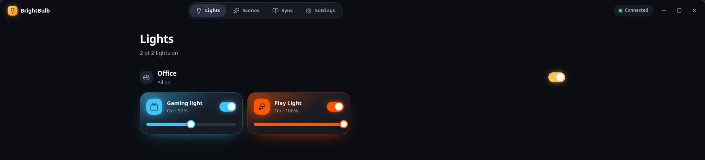
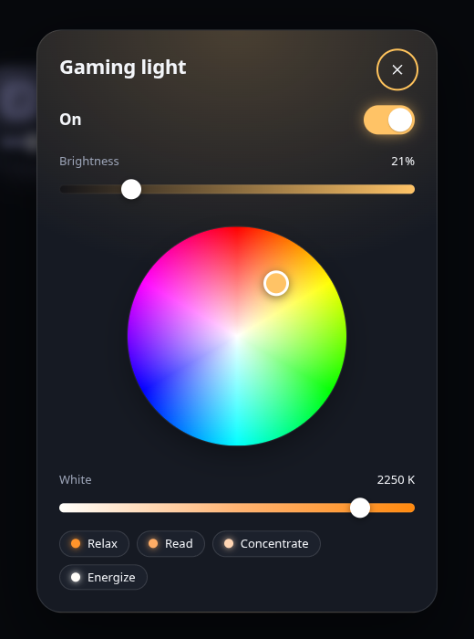
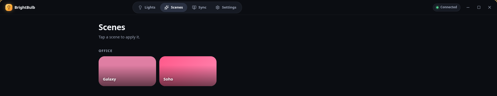

# BrightBulb

Your Philips Hue lights, on your Linux desktop, and following whatever is on your screen. No "pick a screen to share" dialog every time you sit down.

## Key Features

- **Lights**: Every light, grouped by room, as a tile that glows in the light's own colour. Tap one for a colour wheel, warm-to-cool white and the classic Relax/Read/Concentrate/Energize presets.
- **Scenes**: Your Hue scenes as palette tiles, with the active one marked. One tap applies it.
- **Screen mirroring**: Streams your screen's colours to a Hue entertainment area at up to 60 fps. Each lamp follows the part of the screen it actually sits next to.
- **No prompts**: Captures through wlroots screencopy, KMS or X11 instead of the screen-sharing portal, so mirroring just starts. Your compositor will stop asking you questions. Mostly.
- **Pick your screen**: Live thumbnails of every monitor. Mirror a specific one or let it follow the focused screen.
- **Live preview**: See what the lights see: the sampled screen next to a map of your entertainment area, every lamp in its live colour.
- **Lives in the tray**: Close the window and mirroring carries on. Toggle it from the tray menu without opening anything.
- **Works with the Bridge Pro**: Finds bridges over mDNS, the Hue cloud or a typed IP, and talks to them over HTTPS with the certificate pinned at pairing.


<sup>The Lights page. Each tile glows in its light's current colour.</sup>


<sup>Colour wheel, white temperature and presets for a single light.</sup>


<sup>Scenes, drawn from their own palettes.</sup>

## Installing

### Arch Linux (AUR)

```fish
paru -S brightbulb-git
```

Then install a capture tool for your desktop (see below). On Hyprland or Sway that is just `wf-recorder`.

### From source

```fish
make
sudo make install PREFIX=/usr/local ELECTRON=electron43
```

`ELECTRON` is the Electron binary the launcher runs; it must be the same major version as in `package.json` (43). Debian and Ubuntu users can point it at any Electron 43 build.

## Screen capture

BrightBulb picks the first method that works on your system. You can see what it found, and what to install, under **Settings → Screen capture**, and force one under **Sync → Advanced**.

| Method | Works on | Needs |
|---|---|---|
| wlroots screencopy | Hyprland, Sway, river, niri and other wlroots compositors | `wf-recorder` |
| KMS | Any desktop (GNOME, KDE, …), any GPU including NVIDIA | `gpu-screen-recorder` and `ffmpeg` |
| X11 | X11 sessions | `ffmpeg` |
| ffmpeg kmsgrab (experimental) | AMD and Intel | `ffmpeg` with `cap_sys_admin` |
| Screen-sharing portal | Everywhere, as a last resort | Asks which screen every time |

## Using it

Open BrightBulb, press **Find my bridge**, then press the round button on top of the bridge when asked. That's it. **Ctrl+1–4** switch between Lights, Scenes, Sync and Settings.

### Mirroring

Create an entertainment area in the Hue app first (Settings → Entertainment areas), placing the lamps roughly where they are around your screen. Then hit the big button on the Sync page.

If your lights mirror the wrong way round, flip **Screen is at the far end**. It changes which end of the room BrightBulb treats as holding the screen. If a single light follows the wrong region, its position in the Hue app is probably not where it physically is.

### The tray

Closing the window hides BrightBulb to the tray, so mirroring keeps going. Clicking the tray icon brings it back, and the tray menu can start or stop mirroring. Turn off **Close to tray** in Settings if you would rather the close button quit. Quitting, from the tray or with **Ctrl+Q**, always releases the entertainment area so other Hue apps can use it.

This needs something showing a tray: Waybar's `tray` module, Quickshell, KDE, or GNOME with the AppIndicator extension. Without one, closing the window quits, because hiding into a tray that isn't there would leave no way back.

### Coming from BrightBulb 1.x

Your settings and bridge keys carry over: v2 reads the same `~/.config/brightbulb/settings.json` and imports the keys 1.x stored in your keyring, so there is nothing to re-pair. 1.x can still read the file afterwards.

## Technical details

- **Stack**: Electron 43, React 19 and SCSS (Base UI primitives, Lucide icons), built with Electron Forge and Vite. TypeScript throughout.
- **Processes**: The main process owns the bridge (CLIP v2 over HTTPS with a pinned certificate, the event stream, light writes, entertainment start/stop). Capture, colour processing and the DTLS stream run in a separate utility process, so UI work can't stall a frame, and a crash there still releases the area.
- **Mirroring path**: capture tool (scaled to 64×36 by ffmpeg) → linear light → Gaussian region per lamp → saturation, brightness, smoothing → HueStream v2 over DTLS-PSK (`node-dtls-client`).
- **Secrets**: The bridge keys are encrypted with Electron's `safeStorage`, which uses your Secret Service keyring (`gnome-keyring`, KWallet…). On Hyprland and Sway, BrightBulb points Chromium at the keyring explicitly, since it would otherwise fall back to an unencrypted store.

### Development

```fish
npm ci
npm start                            # run with hot reload
npm run lint; npm run typecheck; npm test
BRIGHTBULB_DEBUG=1 npm start         # verbose logs, DevTools on port 9229
```

`npm run spike:dtls` streams a test pattern to an entertainment area, which is handy for checking a bridge without the UI.

## License

GPL-3.0-or-later. See [LICENSE](LICENSE).

BrightBulb is not affiliated with or endorsed by Signify / Philips Hue.
